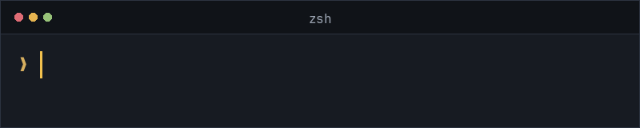
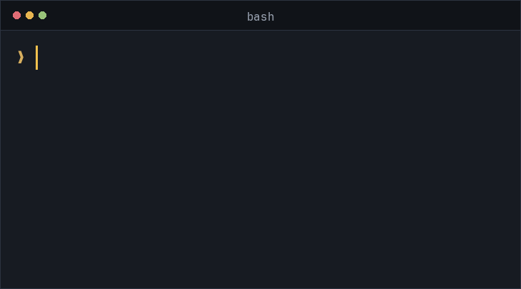

<p align="center">
  <a href="README.md">English</a>
</p>

<p align="center">
  
</p>

<h1 align="center">cmdgen</h1>

<p align="center">
  <strong>把自然语言写成当前 Shell 的命令。</strong><br>
  AI-powered shell command generation for your terminal.
</p>

<p align="center">
  <a href="https://github.com/muzhix/cmdgen/actions/workflows/ci.yml"></a>
  &nbsp;
  <a href="https://github.com/muzhix/cmdgen/releases/latest"></a>
  &nbsp;
  <a href="LICENSE"></a>
  &nbsp;
  
  &nbsp;
  
</p>

<p align="center">
  
</p>

`cmdgen` 把一句自然语言转成当前操作系统和 Shell 能用的命令。它是独立、轻量的 BYOK 工具：默认调用 DeepSeek，也可以改成任何 OpenAI-compatible Chat Completions 接口。

生成结果只打印到标准输出，或在 Zsh / Bash 里填回输入行。你先看、按需改，再自己按 Enter。cmdgen 不会执行生成的命令。

界面语言默认是英文。错误和诊断写到标准错误，并跟随当前界面语言。

## 界面语言

只影响这一次、不写回配置：

```bash
cmdgen --lang zh "列出所有 docker 容器"
cmdgen --lang en --help
```

`en-US` 视为 `en`，`zh-CN` 和 `zh-Hans` 视为 `zh`。环境变量 `CMDGEN_LANG` 作用相同。持久默认写在 `config.toml` 的 `language`。优先级：

1. `--lang`
2. `CMDGEN_LANG`
3. `language`
4. 内置 `en`

Ctrl+G 调用 cmdgen 时不会带 `--lang`，快捷键路径读到的是配置文件里的 `language`。`cmdgen config init` 会写入 `language`：有 `--lang` 或 `CMDGEN_LANG` 时用那个值，否则写 `en`。未知语言代码用英文报错，并列出支持的代码。

## 它做什么

- 把描述变成一条命令。标准输出里只有这行命令，可以直接管道接走。
- Zsh 把建议显示成 ghost text，`Tab` 或右方向键接受。Bash 在成功后替换当前输入行。默认快捷键是 `Ctrl+G`。
- 你自己保管 API Key。Key 不进 `config.toml`，也不进命令行参数。
- macOS 和 Linux 提供预编译二进制，不需要安装 Rust。

它不聊天、不记对话、不做代码生成、Agent、工具调用或 MCP，也不读取命令历史、环境变量和目录里的文件。Fish 和纯 POSIX sh 的输入行快捷键不在范围内。

## 安装

macOS 和 Linux：

```bash
curl -fsSL https://raw.githubusercontent.com/muzhix/cmdgen/main/install.sh | bash
```

脚本按当前系统选择 [GitHub Release](https://github.com/muzhix/cmdgen/releases/latest) 里的压缩包，校验 sha256（发布里带有 `SHA256SUMS` 时），并安装到已经在 `PATH` 里、且当前用户可写的目录，优先 `~/.local/bin`。它不会修改 `~/.zshrc` 或 `~/.bashrc`。

指定版本或目录：

```bash
curl -fsSL https://raw.githubusercontent.com/muzhix/cmdgen/main/install.sh | bash -s -- --version v0.1.2
CMDGEN_BIN_DIR="$HOME/.local/bin" curl -fsSL https://raw.githubusercontent.com/muzhix/cmdgen/main/install.sh | bash
```

不带 `--version` 时安装最新 Release。如果安装目录不在 `PATH` 里，脚本会打印需要加到启动文件的那一行，但不会自己写入。

只删除二进制，不删除配置和凭据：

```bash
curl -fsSL https://raw.githubusercontent.com/muzhix/cmdgen/main/install.sh | bash -s -- --uninstall
```

启动文件里还有 Shell 集成时，卸载会停下来，并提示先运行 `cmdgen shell uninstall`。

也可以从 Release 下载对应平台的压缩包，自行把里面的 `cmdgen` 放到 `PATH`：

- `aarch64-apple-darwin`
- `x86_64-apple-darwin`
- `x86_64-unknown-linux-gnu`
- `aarch64-unknown-linux-gnu`

Windows 不在发布范围内。从源码安装见 [DEV.md](DEV.md)。

## 快速开始

```bash
cmdgen config init
cmdgen config set-key
cmdgen "列出所有 docker 容器，包括已经停止的"
```

`set-key` 会隐藏输入。系统凭据存储可用时，Key 保存到服务名 `cmdgen`、账号为当前 provider 名称的条目。macOS 使用登录钥匙串；Linux 使用 Secret Service。凭据存储不可用时，写入同目录的 `credentials.toml`（权限 `0600`）。关掉终端后再打开仍然有效。同一用户下的其他进程可以读取该文件。容器和 CI 请在每次启动时注入 `CMDGEN_API_KEY`，不要依赖这个文件。

成功时标准输出只有命令，例如 `docker ps -a`。

要在输入行里直接用，再装集成：

```bash
cmdgen shell install zsh
source ~/.zshrc
```

然后输入自然语言，按 `Ctrl+G`。

## 直接生成

<p align="center">
  
</p>

```bash
cmdgen "list all docker containers, including stopped ones"
cmdgen "find files larger than 100MB"
cmdgen "show the last 200 lines of the nginx logs"
```

上面动图里的命令是示例结果，实际输出由模型决定。在交互式终端里等待时，标准错误会显示转圈，结束或失败后擦掉。把标准错误重定向或接入管道时不显示，成功时标准错误仍然为空。

选项写在描述前面：

```bash
cmdgen --shell zsh --model deepseek-flash "查看 git 状态"
cmdgen -- --config
cmdgen -- "-n 列出当前目录"
```

`--` 后面的内容全部当作描述。因此 `cmdgen -- config` 会生成命令，而 `cmdgen config` 是配置子命令。

单次覆盖参数：`--provider`、`--model`、`--base-url`、`--shell`、`--timeout`、`--verbose`。除了 `config set` 会保存 `--model` 和 `--base-url`，这些参数都只影响这一次。`--verbose` 只向 stderr 输出模型、接口和耗时，不输出 API Key，也不输出完整 prompt。

## 命令

| 命令 | 作用 |
| --- | --- |
| `cmdgen "<描述>"` | 生成命令并打印到 stdout |
| `cmdgen config init` | 创建默认配置文件 |
| `cmdgen config show` | 显示有效配置，Key 脱敏 |
| `cmdgen config providers` | 列出已保存的 provider，并标出当前项 |
| `cmdgen config use <name>` | 把当前 provider 写入配置文件 |
| `cmdgen config set` | 把 `--model` 或 `--base-url` 写入配置 |
| `cmdgen config set-key` | 隐藏输入 API Key |
| `cmdgen config delete-key` | 删除当前 provider 已保存的凭据 |
| `cmdgen shell install zsh\|bash` | 安装输入行集成 |
| `cmdgen shell uninstall [zsh\|bash]` | 删除 cmdgen 管理的集成 |
| `cmdgen doctor` | 检查配置、Key 来源、网络和集成 |
| `cmdgen --version` / `--help` | 版本和帮助 |

非交互环境删除凭据需要显式确认：`cmdgen config delete-key --yes`。

`config set` 可以只写 `--model` 或 `--base-url` 其中一个。`--provider` 省略时修改当前 `active`，不会切换当前项。`CMDGEN_MODEL` 和 `CMDGEN_BASE_URL` 不会被写入。

给某一家保存 Key：`cmdgen config set-key --provider bailian`。单次切换不改文件：`cmdgen --provider bailian "列出大文件"`。`--provider` 等选项要写在 `config` 之后；写在前面时，`config` 会被当成描述。

## 配置

配置文件位于：

- 设置了 `XDG_CONFIG_HOME` 时：`$XDG_CONFIG_HOME/cmdgen/config.toml`
- 否则：`~/.config/cmdgen/config.toml`

目录权限尽量为 `0700`，配置文件为 `0600`。API Key 不会写入这个文件。

非敏感配置的优先级：

1. 命令行参数
2. 环境变量
3. TOML
4. 内置默认值

| 变量 | 作用 |
| --- | --- |
| `CMDGEN_API_KEY` | 通用 API Key，优先于下面的凭据来源 |
| `CMDGEN_PROVIDER` | provider 名称 |
| `CMDGEN_BASE_URL` | API 前缀，不要包含 `/chat/completions` |
| `CMDGEN_MODEL` | 模型 ID |
| `CMDGEN_SHELL` | 目标 shell。集成脚本会设置为 `zsh` 或 `bash` |
| `CMDGEN_TIMEOUT` | 超时秒数 |
| `CMDGEN_LANG` | 界面语言，`en` 或 `zh` |
| `DEEPSEEK_API_KEY` | DeepSeek 的 Key |
| `DASHSCOPE_API_KEY` | 阿里云百炼的 Key |

Shell 识别顺序：`--shell` > `CMDGEN_SHELL` > 配置里的 `shell.default` > `$SHELL` 的文件名 > `sh`。`auto` 表示继续向下识别。检测不会启动新的 Shell 进程。

选中哪一家 provider：

1. `--provider`
2. `CMDGEN_PROVIDER`
3. 配置里的 `active`；旧的单个 `[provider]` 则使用它的 `name`
4. 内置 `deepseek`

选中后使用该档案自己的 `base_url` 和 `model`。`--base-url`、`CMDGEN_BASE_URL`、`--model`、`CMDGEN_MODEL` 仍可覆盖这一次的单项。内置预设是 `deepseek` 和 `bailian`，可以不写地址和模型。其他名称必须在 `[providers.<name>]` 里写上这两项，或在命令行同时给出。没有配置文件时默认使用 `deepseek`。

API Key 使用单独的顺序：

1. `CMDGEN_API_KEY`
2. 该档案的 `api_key_env`。没写时，`deepseek` 使用 `DEEPSEEK_API_KEY`，`bailian` 使用 `DASHSCOPE_API_KEY`。新的 `[providers.<name>]` 不会再落入 `OPENAI_API_KEY`
3. 系统凭据存储中、账号等于 provider 名称的凭据
4. 本地凭据文件 `credentials.toml` 中、同一 provider 的凭据

旧的单个 `[provider]` 且名称不是 `deepseek` 时，第 2 步仍是 `OPENAI_API_KEY`。

`cmdgen config init` 写出的默认配置：

```toml
language = "en"
active = "deepseek"

[providers.deepseek]
base_url = "https://api.deepseek.com"
model = "deepseek-flash"

[providers.bailian]
base_url = "https://dashscope.aliyuncs.com/compatible-mode/v1"
model = "qwen3.8-flash"
api_key_env = "DASHSCOPE_API_KEY"

[generation]
temperature = 0.0
max_tokens = 256
timeout_secs = 20

[shell]
default = "auto"
keybinding = "ctrl-g"
include_cwd = false
```

切到百炼：

```bash
cmdgen config set-key --provider bailian
cmdgen config use bailian
```

`api_key_env` 只写环境变量名，不写密钥。百炼预设使用华北 2（北京）的共用域名，不包含业务空间 ID。若要改用业务空间专属域名，运行 `cmdgen config set --provider bailian --base-url <url>`。只想改这一次时，仍用 `--base-url`。

旧的 `[provider]` 表仍然可以读取；它和 `[providers]` 不能同时出现。其他 OpenAI 兼容服务可以写成 `[providers.<name>]`，或用 `cmdgen config set --provider <name> --base-url <url> --model <model>` 创建。

`deepseek-flash` 不是永久有效的模型名。如果官方更换，请修改配置里的 `model`。DeepSeek 默认开启思考模式，cmdgen 在 provider 为 `deepseek` 时发送 `thinking.type=disabled`，以便直接返回命令。

`base_url` 是 API 前缀。客户端只拼接一次 `/chat/completions`，不会重复追加 `/v1`。非本机地址必须使用 HTTPS，且不能关闭证书校验。`127.0.0.1` 和 `localhost` 允许 HTTP，便于连接本机兼容服务。

`shell.include_cwd` 默认为 `false`。只有设为 `true` 时，请求才会附带当前工作目录路径，不会上传目录内容、历史或环境变量。

## Shell 集成

默认快捷键是 `Ctrl+G`。要改成别的键，在配置里写 `shell.keybinding = "ctrl-x"`，然后重新安装。目前只支持 `ctrl-<字母>`。

```bash
cmdgen shell install zsh
source ~/.zshrc

cmdgen shell install bash
source ~/.bashrc
```

重复安装不会追加第二段托管代码。卸载只删除 cmdgen 的标记区块和它自己的脚本：

```bash
cmdgen shell uninstall zsh
cmdgen shell uninstall bash
cmdgen shell uninstall
```

标记形如：

```bash
# >>> cmdgen managed integration >>>
source "$HOME/.config/cmdgen/integration.zsh"
# <<< cmdgen managed integration <<<
```

集成行为：

- 输入为空或只有空白时不发请求。
- 生成期间在输入行末尾转圈。此时再按任意键会取消请求，并保留原始输入；这个按键不会插入到输入行。
- Zsh 在结果是单行命令时不改已输入的文字，把建议显示成 ghost text。`Tab` 或右方向键接受，光标移到末尾。继续输入并偏离建议时 ghost 消失。建议还在时再按一次快捷键会重新生成。Enter 执行的是已经打出来的文字，不是 ghost。`rm`、`kill` 这类破坏性命令会标成红色并带 `⚠`，接受前不会进入输入行。不完整、会让 Shell 继续等待输入的建议会被丢弃。多行结果直接写入输入行。
- Bash 在成功且结果非空时替换当前输入行，光标移到末尾。没有 ghost text。
- 失败时保留原始输入。
- 不会 `eval`，也不会自动按 Enter。

要把单词 `shell` 当作描述，请写成 `cmdgen -- shell`。颜色可以用 `CMDGEN_HIGHLIGHT` 和 `CMDGEN_HIGHLIGHT_DESTRUCTIVE` 覆盖，格式与 Zsh 的 `region_highlight` 相同。

Bash 集成使用 `bind -x`，需要 Bash 4 或更高版本。macOS 自带的 Bash 3.2 不能绑定快捷键；可以用 Homebrew 安装新版 Bash。Zsh 使用 ZLE，不依赖特定终端模拟器。

## 诊断

```bash
cmdgen doctor
```

它检查配置、Key 来源、凭据存储、API 连通性和集成文件。输出里的 Key 会脱敏。存在失败项时退出码为 1。网络检查只访问 `base_url`，不发送 API Key，也不发起补全请求。

## 退出契约

| 情况 | stdout | stderr | 退出码 |
| --- | --- | --- | --- |
| 成功 | 只有命令 | 默认无输出 | 0 |
| 缺少 Key、超时、HTTP/API 错误、响应无法解析、配置错误 | 空 | 界面语言的说明，不含 Key | 非零 |

调试栈信息只在设置 `CMDGEN_DEBUG` 时出现。

## 安全

- 不执行模型输出，没有 `--execute`。
- 不把 Key 写入 `config.toml`、日志、错误信息或 Shell 历史。不要运行 `cmdgen config set-key <密钥>`。系统凭据存储不可用时，Key 只写入权限为 `0600` 的 `credentials.toml`。
- 默认不记录 prompt、响应或命令历史，也不上传环境变量和文件内容。
- 只使用 HTTPS。远程地址不能关闭 TLS 证书校验。
- 提示词会要求模型优先给出非破坏性命令。这不能消除风险，执行前必须自己检查。
- 删除、覆盖、改权限、拉取远程脚本或影响生产环境的命令尤其要人工确认。

## 故障排查

- **未找到 API Key**：运行 `cmdgen config set-key`，或导出 `CMDGEN_API_KEY`。没有钥匙串或 Secret Service 时，`set-key` 会把 Key 写入 `credentials.toml`。只在当前终端临时使用时，导出环境变量即可，关闭终端后失效。
- **base_url 无效**：去掉末尾的 `/chat/completions`，并确认远程地址是 `https://`。
- **请求超时**：增大 `generation.timeout_secs` 或设置 `CMDGEN_TIMEOUT`。默认 20 秒，不会自动重试。
- **返回解释文字**：cmdgen 会拒绝明显的说明文本。把需求写得更具体后重试。
- **Bash 没有反应**：确认 `bash --version` 至少是 4，并且已经 `source ~/.bashrc`。
- **快捷键冲突**：安装时如果发现已有绑定会警告。把 `shell.keybinding` 改成其他 `ctrl-<字母>` 后重新安装。

## 已知限制

- 不做通用聊天、多轮对话、代码生成、Agent、工具调用或 MCP。
- 不支持 Fish，也不承诺纯 POSIX sh 的输入行快捷键。
- 不缓存请求，也不提供常驻守护进程。
- Windows 不在本版本的发布范围内。
- 模型输出只是建议，语法和语义都可能是错的。

## 开发

维护本仓库、跑测试和重新录制上面的终端演示，见 [DEV.md](DEV.md)。

## 许可

[MIT](LICENSE)
